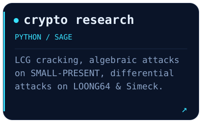
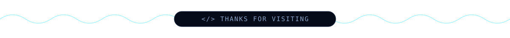

<a href="https://wondping0.github.io">
  <picture>
    <source media="(max-width: 767px)" srcset="assets/header-mobile.svg">
    <source media="(prefers-color-scheme: light)" srcset="assets/header-light.svg">
    
  </picture>
</a>
  

  
  
  

<picture>
    <source media="(max-width: 767px)" srcset="assets/terminal-mobile.svg">
    <source media="(prefers-color-scheme: light)" srcset="assets/terminal-light.svg">
    
  </picture>

## Things I build

  <a href="https://wondping0.github.io/wondev/"><picture>
    <source media="(prefers-color-scheme: light)" srcset="assets/card-wondev-light.svg">
    
  </picture></a>
  <a href="https://wondping0.github.io/q-agent/"><picture>
    <source media="(prefers-color-scheme: light)" srcset="assets/card-q-agent-light.svg">
    
  </picture></a>
  <a href="https://wondping0.github.io/ayas-playground/"><picture>
    <source media="(prefers-color-scheme: light)" srcset="assets/card-ayas-playground-light.svg">
    
  </picture></a>
  <a href="https://wondping0.github.io/#research"><picture>
    <source media="(prefers-color-scheme: light)" srcset="assets/card-research-light.svg">
    
  </picture></a>

## Toolbox

  <picture>
    <source media="(prefers-color-scheme: light)" srcset="https://skillicons.dev/icons?i=go%2Cts%2Cpy%2Cjs%2Cnodejs%2Cvue%2Creact%2Cdart%2Cflutter&amp;theme=light&amp;perline=5">
    
  </picture>
  <picture>
    <source media="(prefers-color-scheme: light)" srcset="https://skillicons.dev/icons?i=c%2Ccs%2Cjava%2Ckotlin%2Cphp%2Cdocker%2Clinux%2Cgit%2Csqlite&amp;theme=light&amp;perline=5">
    
  </picture>

## Contribution snake

  <picture>
    <source media="(prefers-color-scheme: dark)" srcset="https://raw.githubusercontent.com/wondping0/wondping0/output/snake-dark.svg">
    <source media="(prefers-color-scheme: light)" srcset="https://raw.githubusercontent.com/wondping0/wondping0/output/snake-light.svg">
    
  </picture>

  <picture>
    <source media="(prefers-color-scheme: light)" srcset="assets/footer-light.svg">
    
  </picture>

<!-- Assets are generated by scripts/build-assets.py. Picture sources select the phone layout and GitHub theme; 400px cards wrap to one column on narrow screens. -->
